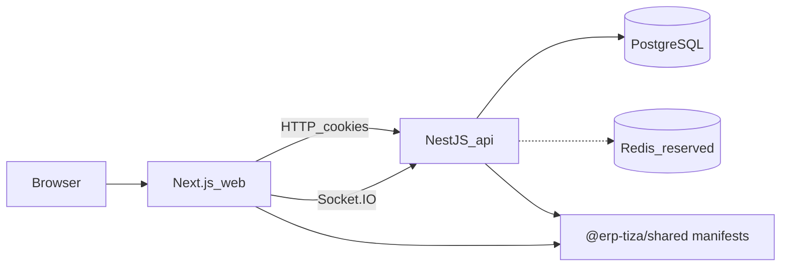

# ERP Tiza architecture (for agents)

This document is the source of truth for how the life-manager shell is structured. Read it before adding features. Prefer extending existing modules over inventing parallel systems.

Companion docs:

- [ADDING_APPS.md](./ADDING_APPS.md) — how to ship a new mini-app
- [../README.md](../README.md) — setup and run commands

---

## 1. Product shape

ERP Tiza is a **modular life OS**, not a single monolithic feature app.

| Concept | Behavior |
|---|---|
| Personal workspace | Created automatically on signup. Private. No invites. |
| Shared workspace | Optional. Owner/admin can invite members. Collaboration lives here. |
| Installable apps | Workspace-scoped. Admins install/uninstall. Apps declare dependencies. |
| Cross-app links | Generic table for interconnect (Odoo-like). Apps do not share tables. |
| Platform services | Files / AI / Integrations / Goals — contracts exist; implement when first needed. |

Phase 1 shipped the **shell**. **Projects** and **Tasks** are the first available mini-apps (`status: available`); other catalog entries remain stubs (`coming_soon`).

Vision roadmap (do not build unless asked):

1. Near-term: calendar, notes, costs, chat
2. Mid-term: learning, work finder, goals
3. Later: AI coach, fitness / wearables

---

## 2. Monorepo layout

```
erp_tiza/
  apps/
    api/                 NestJS modular monolith (port 3001)
    web/                 Next.js App Router shell (port 3000)
  packages/
    shared/              Zod schemas + AppManifest catalog (build before consumers)
  docs/
    ARCHITECTURE.md      this file
    ADDING_APPS.md
  docker-compose.yml     postgres + redis
  .env.example
```

Package manager: **pnpm workspaces + Turbo**.

Important scripts (repo root):

```bash
pnpm install
docker compose up -d
pnpm db:migrate
pnpm --filter @erp-tiza/shared build
pnpm dev                  # shared watch + api + web
```

Env:

- Root `.env` for API (`DATABASE_URL`, `REDIS_URL`, `SESSION_SECRET`, `CORS_ORIGIN`, `PORT`)
- `apps/web/.env.local` for `NEXT_PUBLIC_API_URL`

---

## 3. High-level runtime



- Auth is **HTTP-only cookie sessions** (`tiza_session`), not JWTs in localStorage.
- CORS is credentialed (`credentials: true` both sides).
- Redis is up for later queues/pubsub; phase 1 sessions and notifications use Postgres.

---

## 4. Backend (`apps/api`)

### 4.1 Nest modules

| Module | Responsibility |
|---|---|
| `AuthModule` | signup / login / logout; claims pending invites on signup |
| `SessionService` | create/destroy/resolve sessions (no circular deps with notifications) |
| `UsersModule` | user lookup/create + DTO mapping |
| `WorkspacesModule` | personal + shared workspaces, members, invites, role checks |
| `AppsModule` | catalog from shared manifests; install/uninstall + dependency rules |
| `NotificationsModule` | persist notifications; domain-event listeners; Socket.IO gateway |
| `LinksModule` | list/create/delete `cross_app_links` (Calendar is the first writer) |
| `CalendarModule` | events, recurrence expansion, ICS feed; Tasks via events + links only |
| `HealthModule` | `GET /health` |

Platform contracts (interfaces only): `apps/api/src/platform/platform.contracts.ts`.

### 4.2 Auth / session design

```
AuthController
  -> AuthService (signup/login/logout + claim invites)
  -> SessionService (token hash in `sessions` table)
  -> WorkspacesService.createPersonalWorkspace on signup
AuthGuard
  -> SessionService.resolveUserFromSessionToken(cookie)
NotificationsGateway
  -> SessionService (same cookie parsing over WS handshake)
```

Rules:

- Never put session resolution back on `AuthService` if notifications need it — that recreates an ESM circular dependency (`AuthService` ↔ `NotificationsService`).
- Passwords: `bcryptjs`. Session tokens: random bytes, store **SHA-256 hash** only.
- Cookie: `httpOnly`, `sameSite=lax`, `secure` from `COOKIE_SECURE`.

### 4.3 Authorization model

Route access is enforced by guards. Services do not repeat those checks.

- `AuthGuard` resolves the session cookie onto `request.user`.
- `WorkspaceAccessGuard` with `@WorkspaceRoles(...)` calls `WorkspacesService.requireMembership`. The workspace id is `params.id`. Missing role metadata fails closed.
- `AppInstalledGuard` with `@InstalledApp(appKey)` calls `AppsService.assertInstalled` on app-scoped routes. Missing app metadata fails closed.

Role lists live in `apps/api/src/common/guards/workspace-access.guard.ts`:

- `WORKSPACE_READ_ROLES`: `owner` | `admin` | `member` | `guest`
- `WORKSPACE_WRITE_ROLES`: `owner` | `admin` | `member`
- `WORKSPACE_ADMIN_ROLES`: `owner` | `admin`

Member status: `invited` | `active`

Services still enforce rules that are not the caller's route access: an assignee must be a member, personal workspaces reject invites, and install still checks dependencies.

When adding a mini-app controller:

1. `@UseGuards(AuthGuard, WorkspaceAccessGuard, AppInstalledGuard)`
2. `@InstalledApp('<appKey>')` on the controller
3. `@WorkspaceRoles(...)` on each route

Apps do not import each other's tables. A cross-app read goes through a port the owning app exports (`TaskReferencesService` is the pattern). Install seeds listen for `app.installed` inside that app. `AppsService` does not special-case app keys. `install` and `uninstall` await `emitAsync` so those listeners finish before the response.

### 4.4 Domain events

`apps/api/src/common/events/domain-events.ts` + Nest `EventEmitterModule`.

Current events:

- `member.invited`
- `app.installed` / `app.uninstalled`
- `workspace.created`

`NotificationsService` listens and writes rows + emits Socket.IO `notification.created` to `user:{userId}` rooms.

Pending invites before the invitee exists: on signup, `AuthService.claimPendingInvites` attaches `userId` and creates a notification.

### 4.5 Database (Drizzle + Postgres)

Schema: `apps/api/src/db/schema.ts`  
Migrations: `apps/api/drizzle/` via drizzle-kit.

Core tables:

| Table | Purpose |
|---|---|
| `users` | accounts |
| `sessions` | cookie session hashes |
| `workspaces` | personal/shared |
| `workspace_members` | membership + invite tokens |
| `workspace_apps` | installed apps per workspace |
| `notifications` | in-app notifications |
| `cross_app_links` | inter-app references |
| `integration_accounts` | reserved for OAuth/wearables |

Notes:

- App catalog is **code-defined** in `@erp-tiza/shared` (`APP_MANIFESTS`), not an `app_definitions` table. That keeps manifests versioned with the repo.
- Future mini-app tables must include `workspace_id` and must not FK into another app’s tables. Use `cross_app_links` or events.

Generate / migrate:

```bash
pnpm db:generate
pnpm db:migrate
```

### 4.6 API surface (phase 1)

| Method | Path | Auth |
|---|---|---|
| GET | `/health` | no |
| POST | `/auth/signup` | no |
| POST | `/auth/login` | no |
| POST | `/auth/logout` | cookie optional |
| GET | `/auth/me` | yes |
| GET/POST | `/workspaces` | yes |
| GET | `/workspaces/:id` | yes |
| GET | `/workspaces/:id/members` | yes |
| POST | `/workspaces/:id/invites` | yes (owner/admin, shared only) |
| POST | `/invites/:token/accept` | yes |
| GET | `/apps/catalog` | yes |
| GET | `/workspaces/:id/apps` | yes |
| POST | `/workspaces/:id/apps/install` | yes (owner/admin) |
| DELETE | `/workspaces/:id/apps/:appKey` | yes (owner/admin) |
| GET | `/notifications` | yes |
| PATCH | `/notifications/:id/read` | yes |
| GET | `/workspaces/:id/links` | yes |

Validation: Zod schemas from `@erp-tiza/shared`, parsed in controllers (`.parse(body)`).

---

## 5. Shared package (`packages/shared`)

Build artifact: `packages/shared/dist` (TypeScript `tsc`).

Exports:

- `APP_MANIFESTS`, `getAppManifest`, `AppManifest` types
- Auth / workspace / apps / notification Zod schemas

Manifest contract (do not shrink fields — long-term catalog depends on them):

```ts
{
  key, name, description, version,
  category,          // productivity | learning | career | health | social | finance | ai
  dependsOn,         // other app keys
  permissions,       // e.g. tasks.read
  capabilities,      // ai | files | integrations | goals
  nav: { label, href, icon },
  backendModule,
  status             // available | coming_soon
}
```

Install rules (backend):

- Fail install if any `dependsOn` missing
- Fail uninstall if another installed app lists this key in `dependsOn`

Always rebuild shared after editing manifests:

```bash
pnpm --filter @erp-tiza/shared build
```

---

## 6. Frontend (`apps/web`)

Work surfaces (how a project, task, or the next list-shaped app should behave) live in [UI.md](./UI.md). Copy `TasksWorkspace` instead of inventing a settings form for the main screen.

### 6.1 Stack

- Next.js App Router
- Tailwind v4
- Local shadcn-style primitives in `src/components/ui`, themed by the tokens in [DESIGN.md](./DESIGN.md)
- TanStack Query for server state
- Zustand (+ persist) for shell UI state only
- Socket.IO client for notification invalidation

### 6.2 Routes

| Route | Role |
|---|---|
| `/login`, `/signup` | auth |
| `/w` | redirect to current/personal workspace |
| `/w/[workspaceId]` | workspace home |
| `/w/[workspaceId]/apps` | marketplace |
| `/w/[workspaceId]/settings` | members / invites |
| `/w/[workspaceId]/projects` | project index; a card opens that project's tasks |
| `/w/[workspaceId]/projects/[projectId]` | that project's task list |
| `/w/[workspaceId]/tasks` | All and Today across projects |
| `/w/[workspaceId]/[appKey]` | installed-app placeholder |
| `/invites/[token]` | accept invite |

Shell chrome: `features/shell/app-shell.tsx` (responsive sidebar/drawer, workspace switcher, bell, global task quick-add when Tasks is installed, Cmd/Ctrl+K command palette).

### 6.2.0 Shell command palette registry

Installed apps register commands through `features/shell/command-registry.ts`:

```ts
registerAppCommands('tasks', () => [{ id, appKey, label, keywords?, run }])
```

`ShellCommandPalette` lists commands only for apps installed in the current workspace. Tasks registers navigation and capture; Calendar registers its planning actions. Future apps should register the same way instead of owning a private Cmd+K handler.

### 6.2.1 Responsive cornerstone (required for all new UI)

Mobile-first. Breakpoints use Tailwind defaults (`sm` 640, `md` 768, `lg` 1024).

| Rule | Practice |
|---|---|
| Shell nav | Desktop (`md+`): persistent sidebar. Mobile: hamburger + overlay drawer; closes on route change / Escape / backdrop |
| Page layout | Wrap screens in `PageContainer` + `PageHeader` from `components/layout/page-container.tsx` |
| Grids | Start single column; promote with `sm:grid-cols-2` / `lg:grid-cols-3` — never desktop-only fixed columns |
| Touch targets | Primary controls ≥ ~44px on small screens (`h-11`, full-width buttons OK on mobile) |
| Inputs | `text-base` on mobile to avoid iOS zoom; can tighten at `sm:` |
| Overflow | Prefer `min-w-0`, `truncate`, `break-words` / `break-all` for long emails/tokens |
| Height | Use `min-h-dvh` not only `min-h-screen` for mobile browser chrome |
| Viewport | Root layout exports `viewport` (`device-width`, `initialScale: 1`) |

Do **not** build a separate mobile product IA yet (no bottom tab bar). Keep one shell; adapt layout.

Feature folders:

```
src/features/
  auth/
  workspaces/
  apps/
  notifications/
  shell/
  <future-app>/
```

API helper: `src/lib/api.ts` — `fetch` with `credentials: 'include'`.

### 6.3 State rules

- **Server truth** → TanStack Query (`me`, `workspaces`, `installed-apps`, `notifications`)
- **UI chrome** → Zustand (`currentWorkspaceId`, sidebar, notification drawer)
- Wait for `hasHydrated` from the persist store before reading persisted workspace id (avoids SSR/client flicker)

Do not put Redux in unless there is a strong reason. Prefer a small Zustand store per mini-app if local UI state grows.

### 6.4 Next config notes

`cacheComponents` / partial prefetching were disabled for the authenticated shell — nearly every meaningful page is cookie/session dynamic. Do not re-enable without Suspense/`instant` planning per route.

`transpilePackages: ['@erp-tiza/shared']` is required.

---

## 7. Modularity rules (non-negotiable)

1. **Apps never import each other’s DB tables.**
2. Interconnect via `cross_app_links` and/or domain events.
3. AI / wearables / files go through platform gateways, not ad-hoc SDK calls inside apps.
4. Every app record is workspace-scoped.
5. Marketplace nav is driven by **installed manifests** for the current workspace only.
6. Keep the shell thin: new domains are mini-apps + optional platform modules.

**Reference integration:** Calendar ↔ Tasks. Calendar does not import the `tasks` table. Time blocks use `cross_app_links`; title/due/completion sync listens to `task.*` domain events and reads through `TaskReferencesService` only. See [apps/CALENDAR.md](./apps/CALENDAR.md).

---

## 8. How to add the next mini-app (summary)

Full steps: [ADDING_APPS.md](./ADDING_APPS.md).

Checklist:

1. Add/adjust manifest in `packages/shared` → rebuild shared
2. Create Nest module under `apps/api/src/<app>/` with the workspace and app-installed guards, plus an `app.installed` listener for any seed data
3. Add tables in `schema.ts` + migration
4. Create `apps/web/src/features/<app>/` + real route under `/w/[workspaceId]/...`
5. Emit domain events for anything notifications/AI/goals might care about
6. If you need files/AI/integrations/goals, implement the matching platform module behind the existing contract

First real apps: **Projects** + **Tasks** — see [apps/TASKS.md](./apps/TASKS.md). Calendar is the reference for two apps integrating only via events and links — see [apps/CALENDAR.md](./apps/CALENDAR.md).

---

## 9. Operational pitfalls (agents)

| Symptom | Likely cause | Fix |
|---|---|---|
| `EADDRINUSE :::3001` | Two Nest watchers (orphan + turbo) | Kill the orphan PID; keep a single `pnpm dev` |
| Hydration mismatch with `data-gr-*` | Browser extension (Grammarly etc.) | Harmless; `suppressHydrationWarning` on `<body>` |
| Shared types missing / old manifests | Shared package not rebuilt | `pnpm --filter @erp-tiza/shared build` |
| Cookie auth fails from web | Missing `credentials: 'include'` or CORS origin mismatch | Check `api.ts` and `CORS_ORIGIN` |
| Circular dependency crash involving Auth + Notifications | Session logic imported via AuthService | Use `SessionService` only |

---

## 10. What is intentionally unfinished

- Remaining domain UIs (calendar/notes/…); Projects + Tasks v1 are shipped — see [apps/TASKS.md](./apps/TASKS.md)
- Real `FilesModule` / `AiModule` / `IntegrationsModule` / `GoalsModule` implementations
- BullMQ workers on Redis
- OAuth / SSO
- Email delivery for invites (invite token returned in API for now)
- Mobile clients

Do not “finish” these unless the user asks — keep diffs scoped.

---

## 11. Mental model for upcoming agents

Think **Odoo apps inside a personal+shared workspace shell**:

- Shell owns identity, tenancy (workspaces), marketplace, notifications, links
- Each life domain is a plug-in app with its own Nest module + web feature folder + tables
- Postgres is the system of record; Redis/queues/AI/devices are attachments later
- When unsure, copy patterns from `WorkspacesModule` / `AppsModule` / `features/apps` rather than inventing new architecture
